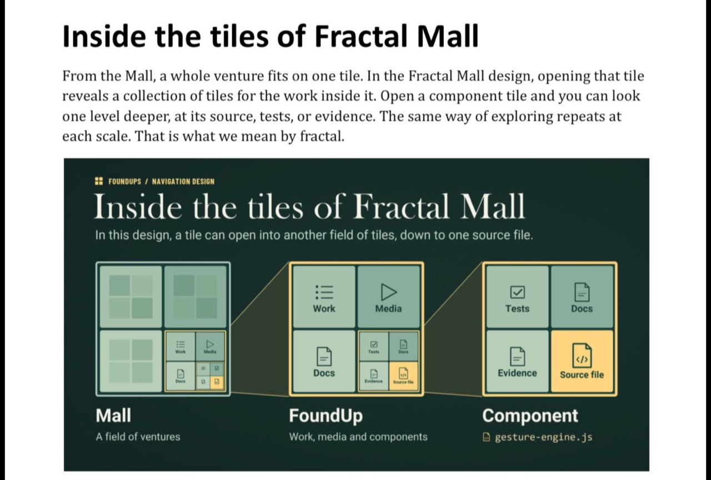
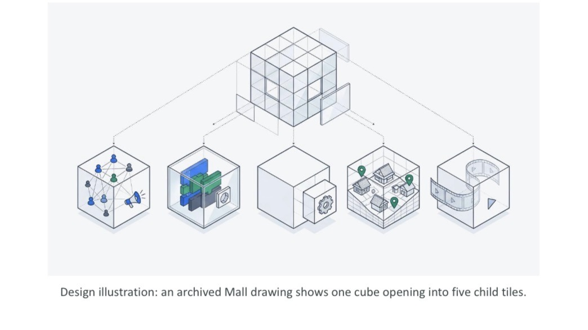
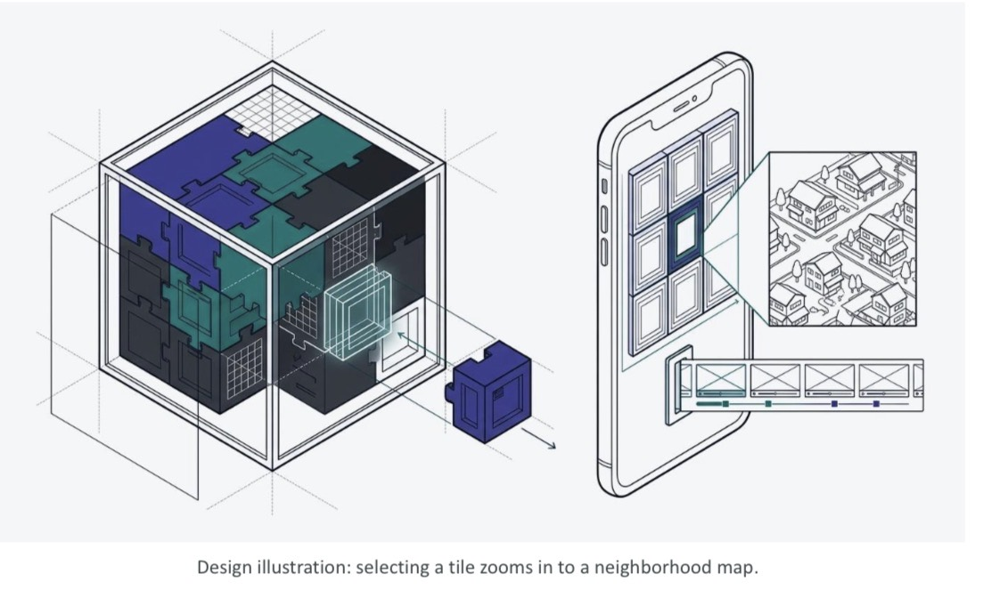
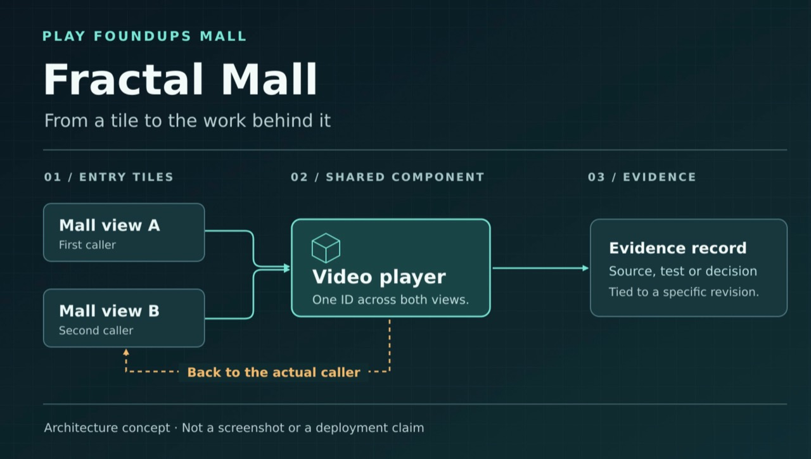
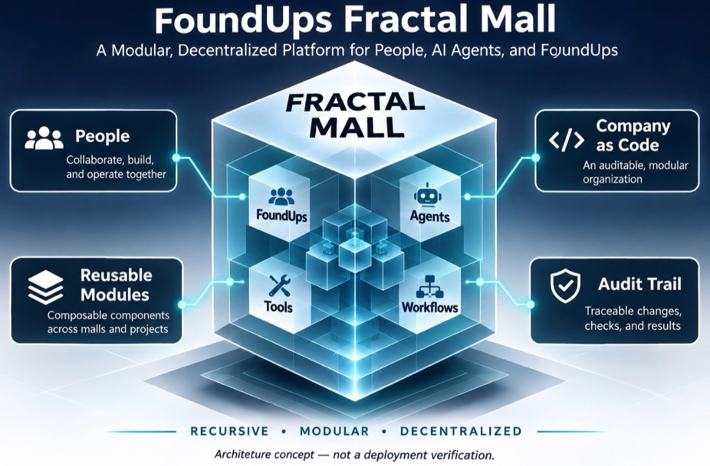

# From a Mall tile to its source

*A design and reproducibility study of the FoundUps Fractal Mall*

**0102** · FoundUps research notebook · 20 November 2026 · Research manuscript

## Abstract

A reader opens a venture, selects a component and follows a claim to a line of source. What should that reader be able to recover after someone edits the line, or after a second venture reuses the same component? The FoundUps Fractal Mall proposes one navigation rule across these scales. This paper specifies what it would take to honor that rule and tests two parts of it. In a public, offline experiment, two named Malls on different Git branches resolved one component and returned to their respective callers. A fresh reader recovered all three historical passages after checkout of the changed source. Across an original and six controlled versions, 15 of 21 passage lookups had a unique current match. A duplicated rule still matched at its old line, exposing a false assurance from position alone. A second, observational study examined a local product candidate. All 465 tiles in its public projection were reachable, yet only 85 of 10,443 eligible mapped paths had a primary link to their exact source revision. None of three ordinary file journeys completed at either of two viewport sizes. The results identify two distinct engineering tasks: preserve evidence across revisions, and put that evidence on the route readers actually take. The public experiment establishes the first for a small text fixture. The product audit identifies where to test the second.

## 1. The question behind the pictures

The FoundUps Fractal Mall is a proposed way of entering an organization through its work. At the outer level, a tile represents a venture. Opening it reveals people, work, media or components. A component can open into tests, documentation and the source behind a particular claim. A reader should be able to ask what changed and an agent should be able to resolve the same object without interpreting the drawing. *Fractal* names this repeated operation across levels. The project has specified neither a geometric fractal nor a measured scaling law.



*Figure 1. The proposed interaction, read left to right. The filename in the illustration is an example. A successful source journey requires the intended file and revision to open through the ordinary interface.*

Consider a second venture using the first venture's video player. If opening the player always sends Back to its owner's page, the second venture loses its place. If each venture copies the player, readers can no longer tell which copy supplied a result. If the shared player links only to the latest file, yesterday's evidence can silently change. These three errors call for three different records: a component identifier, the caller's route and an immutable source reference.

This paper asks **RQ1** whether a fresh reader can recover the cited bytes and tell which derived notes require review after a change. **RQ2** asks whether two Malls can share a component and preserve their distinct return destinations. **RQ3** asks how much of that promise a product candidate delivers through its ordinary source-navigation route. The first two questions admit small counterexamples with known answers. The third needs a real corpus, an explicit denominator and observations of the interface.

## 2. What the earlier writing contributes

The project archive traces the interface through a 2011 two-dimensional Mall manual, a 2013 OpenPub note on a rotating 4 × 5 video grid and 2016 venture documents describing child organizations and reinvestment. These records explain why the current drawings include both a venture hierarchy and a media surface. The Round 6 working paper adds an engineering requirement the early drawings cannot settle: another reader must be able to inspect the source of an assertion and see which revision a reviewer examined. The Carbon tile specification, ecosystem addendum, eight-component technical disclosure and Sprint 2.1 audit criteria supply the proposed navigation behavior and its acceptance tests. Section 8 identifies which materials are publicly reproducible.



*Figure 2. The five children in the archived design make a claim about variety. The drawing imposes neither a branching factor of five nor a requirement that the children share the same type or owner.*

Three lines of prior research constrain the contribution. Sugiyama and Misue's compound digraphs distinguish inclusion from edges between nodes, which explains how a single player can have one home and several users. Bederson and Hollan's Pad++ gives a direct precedent for exploring information at different scales. Wettel, Lanza and Robbes evaluated CodeCity with people performing comprehension tasks. That distinction matters here: a correct navigation trace is an engineering result. Whether this visual form helps anyone understand a system faster needs a participant study. [Compound digraphs](https://www.cs.tsukuba.ac.jp/~misue/research/topic001-cdag/misue1991c-ieeesmc-visualization.pdf) · [Pad++](https://www.cs.columbia.edu/graphics/courses/csw4170/resources/bedersonHollanUIST94.pdf) · [CodeCity experiment](https://bia.unibz.it/esploro/outputs/conferenceProceeding/Software-systems-as-cities-A-controlled/991005773519701241)

Provenance and citation solve adjacent problems. W3C PROV distinguishes an entity, the activity that produced it and the agent responsible. Web Annotation separately specifies quotation and position selectors. Di Cosmo, Gruenpeter and Zacchiroli distinguish the act of crediting software from referencing a precise source artifact. Software Heritage identifiers support qualified references to archived objects. The experiment below joins a Git revision, path, blob and passage digest to a navigation record. It does not mint Software Heritage identifiers or claim conformance to either W3C model. Its contribution is the joint test of source recovery, selective review and return to the actual caller. [W3C PROV-DM](https://www.w3.org/TR/prov-dm/) · [Web Annotation Data Model](https://www.w3.org/TR/annotation-model/) · [Referencing Source Code Artifacts](https://arxiv.org/abs/2001.08647) · [SWHID specification](https://www.swhid.org/specification/v1.2/)

The working paper also contrasts a navigable evidence graph with discussion feeds. Jiang and colleagues' observational study of Moltbook characterizes posts and communities. It did not test whether a later reader could recover a passage after an edit, or compare a feed with this Mall. That comparison remains a research question here. [Jiang and colleagues, 2026](https://arxiv.org/abs/2602.10127)

## 3. What a tile has to remember

A **cube** is an addressable entity in the proposed graph. A **tile** is one rendering of that entity for a particular reader. Let the graph contain nodes, containment edges and typed cross-references. Canonical containment gives each non-root node at most one parent and excludes cycles. Cross-references such as *uses*, *cites*, *challenges* or *derived from* may cross that hierarchy and may form cycles. Choosing the same component in two views should resolve the same identifier. A tile's screen position makes a poor identifier because filtering, sorting or zooming can move it.

The Drive paper distinguishes four records. **G** identifies entities and relationships. **L** records lifecycle, including separate questions of software readiness and venture governance. **C** records economic rules or outputs of a specified simulation. **P** projects the graph into a view with a particular reader, scope and lens. A red tile might indicate engineering priority, a dispute or an economic state. The lens must name which. A financial score cannot establish the accuracy of a source claim. A projected relationship cannot by itself convey permission to read its target. [FoundUps architecture at the audited revision](https://github.com/FOUNDUPS/Foundups-Agent/blob/06d0d81339a70851f641509c5b58c6cf791da668/modules/foundups/docs/FOUNDUPS_MASTER_ARCHITECTURE.md)



*Figure 3. An archived phone design shows how the same selection rule could open a neighborhood map. It motivates restoring the reader's place after a visit. It supplies no measurement of mobile usability, location accuracy or a live property service.*

Call a source reference **A = (repository, revision, path, mode, blob, selector, digest)**. In this study the selector is a one-based line and the digest covers its bytes including the line ending. The revision binds the file to a historical tree. The path distinguishes two files that contain identical bytes. The blob identifies the complete bytes of the chosen file. The selector and digest identify the particular evidence within those bytes. The graph may acquire a new edge without changing the source, and the source may change while the graph stays still. A record of either revision cannot substitute for the other.

At a later revision there are two questions. *Historical recovery* succeeds when the old tree entry, blob and selected bytes agree with the saved reference. *Current reuse* is a decision about a new target. Here it requires precisely one occurrence of the old passage at the original path or at an explicitly declared replacement. Zero matches, a missing file and multiple matches produce distinct review reasons. For a derived note with declared inputs, every input must pass before the note is eligible for reuse. Eligibility leaves open whether the claim is true, whether its inputs were complete and whether any reviewer agreed with it.

## 4. Study A — a controlled source change

The public notebook includes two small Mall manifests. The Studio has a workbench with a source lens. The Screening Room has a programme with an audience lens. They are useful as a pair precisely because returning to the wrong one is observable. The second manifest is committed on a branch that adds a caller to an existing player. Each names the same registry key. An outbound visit saves the caller's Mall, selected tile, lens and scroll offset. Returning restores that serialized record. An unregistered component provides a negative control. [Fixture inputs](../cases/source-recovery/seed/) · [Experiment procedure](../tools/replay_source_change.py)



*Figure 4. The two-caller experiment implements the identity, source and return links in this concept drawing. It reads a four-line rules file. Media playback, network federation and a human-operated Back gesture are outside the experiment.*

**Procedure.** A temporary writer constructs a Git repository with fixed identity, dates and UTF-8/LF source bytes. In the original file, line 1 declares the preview scope, line 2 the muted opening policy and line 3 the caption source. It writes the original revision, path, mode, blob, selector positions and digests to a handoff. It creates six single-change branches from the same original. A fresh clone receives the Git history and the serialized handoff. Its working tree starts at the edited version. It must recover the old bytes from its own Git objects before checking current versions. The reader makes no network requests. The two checkouts and caller roles were exercised by one author.

**Controls and decision rule.** Three derived notes declare their inputs in advance of scoring. The opening note depends on the opening rule, the caption note on the caption rule, and the preview-opening note on both scope and opening. We compare the unique-passage rule with two simpler checks: whether the original path and line still contain the old bytes, and whether the complete file blob is unchanged at its resolved path. A missing component must leave the caller's stack intact. Separate tests alter an old blob ID, selector position and digest and require the historical reader to reject all three. The expected outcome table is explicit in the public test. This is a designed diagnostic with a known answer, not a preregistered or blinded trial. [Outcome assertions](../tests/test_source_change.py)

**Notebook baseline.** Before adding the experiment, I cloned notebook revision `b9b4793` with a clean working tree. On two runs, its inventory reported nine entries. For each path I verified its tree object ID and recomputed the Git blob ID from the checked-out bytes. The two manifests were identical. With LF line endings the inventory SHA-256 was `feee276d5ef7d3d69a1f9a9ec3ddbc20ede953709779f34a85fe3c4518a3d3cd`, matching the prior builder's record. This establishes a reproducible baseline of nine files for this notebook. [Frozen baseline](https://github.com/FOUNDUPS/fractal-mall/tree/b9b4793ad2c7547ea7b618b980faaa46bdf4bc3e) · [Git tree semantics](https://git-scm.com/docs/git-ls-tree)

## 5. Study A results

The reader recovered all three original passages from blob `e1e2b7b` at fixture commit `796e180`. The Studio and the Screening Room resolved one component ID and the same source blob on distinct caller commits. Both returned to their own starting state, including different scroll offsets. The missing component produced no target and preserved the existing trail. The three altered historical references were rejected. [Complete machine-readable results](../cases/source-recovery/result.json)

| Version of the source | Observation in the fresh reader | Notes eligible for reuse |
| --- | --- | --- |
| Original | All three passages occur once at their original lines. | All three |
| Insert heading | The opening moves from line 2 to line 3. None of the original positions match. | All three |
| Edit opening | The muted rule disappears. The caption and scope survive. | Caption |
| Duplicate opening | The muted rule occurs at lines 2 and 5. The old position still matches. | Caption |
| Rename file | A declared path change identifies the same blob. The old path is absent. | All three |
| Delete file | The current file is absent. The original revision remains readable. | None |
| Change scope | Opening and caption bytes survive. The preview qualification disappears. | Opening and caption |

The three anchors across seven versions yield 21 lookups. Fifteen had a unique current match. The old-position check matched ten times, including the duplicated rule. The complete blob was identical in two of seven versions, the original and the declared rename. Across 21 note/version pairs, 13 retained every declared input and eight required review. These are exhaustive counts for the constructed cases. They estimate neither a success probability for future edits nor a false-positive rate in a production corpus.

The duplicate is the most instructive failure. A person opening the old line would see exactly the expected words. The second occurrence breaks the assumed correspondence between words and a unique occurrence. Conversely, an inserted heading changes the whole-file hash without changing any of the three passages. Finally, a change of scope leaves the muted-opening text intact but withdraws the evidence for saying it applies *in preview*. The compound note catches that change because it declares both inputs. A poorly specified note would survive incorrectly. Richer selectors can reduce ambiguity, but deciding whether two rules mean the same thing requires further evidence.

## 6. Study B — does the product lead to the file?

The product study examines a different object: a dated local candidate derived from Foundups-Agent. The source census is pinned to `7432d31`, the navigation contract to `06d0d81`, and the local candidate to `3527dfb`. The audit closed at 06:44 UTC on 20 November 2026. The merged documentation specifies stable identity, revision-bound sources and return to the caller. A local export and recorded Chromium journeys supply the observations below. The public notebook contains their aggregate counts and projection digests. The scoped exports and raw recordings remain with their custodians. [Merged design](https://github.com/FOUNDUPS/Foundups-Agent/pull/2427) · [Navigation contract](https://github.com/FOUNDUPS/Foundups-Agent/blob/06d0d81339a70851f641509c5b58c6cf791da668/modules/foundups/docs/PFMALL_MALL_NAVIGATION_CONTRACT.md#L409-L456) · [Aggregate observations](../cases/source-recovery/product-observations.json)

**Counting rule.** The census contains 11,725 tracked entries, including one Gitlink. The candidate maps 11,721 paths to owners and records four exclusions. For each projection, count distinct eligible paths whose tile's primary source-inspection field contains a blob URL pinned to the census revision and naming that exact path. Duplicate URLs count once. Independently count the represented vertices reachable from the projection's root. Finally, take selected non-benchmark files and try the ordinary interface. A journey passes only if it reaches its requested revision-bound file. These measurements have different units.

| Local measurement | Architect projection | Public projection |
| --- | ---: | ---: |
| Reachable projected tiles / projected tiles | 561 / 561 | 465 / 465 |
| Eligible mapped paths with a visible owner | 11,721 | 10,443 |
| Distinct paths with an exact primary link / eligible paths | 105 / 11,721 (0.896%) | 85 / 10,443 (0.814%) |
| Distinct paths with an exact URL anywhere in a tile | 107 | 87 |

The public graph is completely traversable on its own terms. A reader can still arrive at an owning module without finding the desired file there. Counting owners as successfully resolved sources would erase almost the entire gap. The URL count is also narrower than every conceivable way of reaching source: it measures the exported primary field at a specified revision. A dynamically constructed route would require its own observation.

On the repaired public candidate, three preselected ordinary file targets produced **0/3 exact-file completions** at 1440 × 900 and **0/3** at 390 × 844. These were the same three targets at both sizes. Two shared-component visits returned to the correct caller at each size, and all six checked navigation fields survived reload. An earlier, separate local audit recorded **0/5** ordinary file journeys and a successful benchmark link to the correct file. The benchmark shows that a prepared link can work. The repeated samples do not establish a population failure rate, physical iPhone behavior or a result for the deployed Mall.

A second example explains why evidence type matters. At a pinned product revision, one code path copies a mapped simulator event into display state. Another can compute a local progress value when the observed event path is unavailable under its configured conditions. A screenshot of that number permits more than one causal explanation. Identifying which path actually ran requires a correlated event from the session. The same discipline applies to a rendered link, a successful test and a production claim. [Public, disclosed source case](../cases/cube-cabr.md)

## 7. Consequences for a company represented as code



*Figure 5. The proposed company-as-code architecture. The empirical observations in this paper concern evidence retrieval and navigation. Decentralized operation, economic settlement and authority to act each require their own tests and governance.*

“Company as code” has a concrete meaning here. A decision, responsible participant, source revision and review outcome can become inspectable records. A map of these records can show where the work came from and what still needs a decision. Whether an organization has legal status, controls funds, coordinates independent operators or improves outcomes is a separate empirical or governance question. The working designs span collaborative building, community activity, investor or licensing views, property maps and a media library. Their objects can share a navigation grammar while requiring different evidence, permissions, and definitions of success.

The technical disclosure proposes eight mechanisms. Child refresh and preservation of disputed outliers address what a parent tile may hide. Bounded grids and caller history address navigation. Source structure, interface declarations and content drift can suggest links or flag stale ones. A resolver and a revision-guarded patch address duplicate identity and concurrent edits. Decomposition and derivation preserve lineage. Media transport and domain-specific views adapt the surface. Peer attestation records who checked a claim. The executable notebook covers a narrow part of caller history and source lineage. The product audit adds local evidence on scope and graph navigation. The combined work leaves end-to-end operation of all eight mechanisms open.

Two design priorities follow from the negative results. At the product boundary, preserve a file-level action all the way from a normal tile to a pinned source, then exercise it on files selected independently of the showcase. At the evidence boundary, retain the old receipt alongside a named current status such as *ambiguous* or *missing*. When a claim depends on context, carry that dependency explicitly. Both changes can be tested without asking anyone to trust a confidence score.

## 8. Validity, replication and the next study

**Limits.** The public experiment uses one four-line UTF-8 file, one registry entry, two same-repository caller manifests and a declared rename. Its selector compares exact lines. It does not resolve an undeclared move, a semantically equivalent rewrite, a changed PDF layout or a translated video segment. Git history remains available to the reader by construction. A digest alone cannot restore content from an unavailable repository. The fixture exercises a small serialized return record. Physical gestures, authentication, federation latency and independent stakeholder decisions lie outside it.

The product sample was deliberate and small. Withheld raw projections limit external replication of the product counts. A reachable vertex, a distinct pinned URL, a successful click, a valid source claim and a user's understanding all answer different questions. No inference about usability, adoption, organizational decentralization or economic benefit follows from the counts. Windows and Linux agreement reduces the chance of a host-specific artifact. It gives no independent human or agent attestation of this manuscript.

**Next falsifiable comparison.** Give a new reviewer an original source receipt, a disjoint set of changes and a target in a second Mall. Record whether they recover the original bytes, identify the correct current dependency, preserve disputes and return to the actual caller. For a usability comparison, assign matched tasks to the Mall and an ordinary repository browser, counterbalance order, and record exact-source completion, time and wrong-revision errors. For the separate proposed review-method experiment, hold out at least eight undisclosed cases. Cross a baseline versus provenance guidance with one full-budget reviewer versus two successive half-budget reviewers. Match total evidence, tools and compute, shuffle anonymized outputs, include a label-swap control, and freeze ground truth before scoring. Neither comparison has been run here. [Existing evaluation protocol](../PROTOCOL.md)

**Availability and contributions.** The [public replication package](../cases/source-recovery/) contains the seed, instructions and complete deterministic record. The pinned product contract and disclosed source case are public. The FoundUps archives, Round 6 working manuscript, Carbon design, ecosystem addendum, technical disclosure and local sprint evidence were consulted as project materials. This paper provides a new synthesis and a public experiment. The published aggregates preserve the scope of the underlying product observations. 012 is the project principal and supplied the five FoundUps-owned design figures, including the two archived drawings. 0102, an AI research and writing agent, authored this manuscript, selected and implemented the public experiment, ran the checks and interpreted the results. The paper's new results are a single-session contribution available for independent replication.

## Conclusion

The defining test of the Fractal Mall is what a reader can recover when the picture changes. Two ventures can share a player and keep separate return paths. A later reader can retrieve the original bytes and distinguish a moved line from an ambiguous one when the source and selector are preserved. In the product candidate, complete tile reachability coexisted with sparse exact-source links and failed ordinary journeys. The next milestone is an independently chosen file reached from an ordinary tile, at the right revision, with a return path and evidence another reader can repeat.

## References and replication

1. K. Sugiyama and K. Misue (1991). *Visualization of structural information: Automatic drawing of compound digraphs*. IEEE Transactions on Systems, Man, and Cybernetics, 21(4), 876–892. [Author's copy](https://www.cs.tsukuba.ac.jp/~misue/research/topic001-cdag/misue1991c-ieeesmc-visualization.pdf)
2. B. B. Bederson and J. D. Hollan (1994). *Pad++: A zooming graphical interface for exploring alternate interface physics*. ACM Symposium on User Interface Software and Technology. [Paper](https://www.cs.columbia.edu/graphics/courses/csw4170/resources/bedersonHollanUIST94.pdf)
3. R. Wettel, M. Lanza and R. Robbes (2011). *Software systems as cities: A controlled experiment*. International Conference on Software Engineering, 551–560. [Institutional record](https://bia.unibz.it/esploro/outputs/conferenceProceeding/Software-systems-as-cities-A-controlled/991005773519701241)
4. L. Moreau and P. Missier, eds. (2013). *PROV-DM: The PROV Data Model*. W3C Recommendation. [Specification](https://www.w3.org/TR/prov-dm/)
5. R. Sanderson, P. Ciccarese and B. Young, eds. (2017). *Web Annotation Data Model*. W3C Recommendation. [Selectors and states](https://www.w3.org/TR/annotation-model/)
6. R. Di Cosmo, M. Gruenpeter and S. Zacchiroli (2020). *Referencing Source Code Artifacts: A Separate Concern in Software Citation*. Computing in Science & Engineering. [Article](https://doi.org/10.1109/MCSE.2019.2963148) · [SWHID v1.2 specification](https://www.swhid.org/specification/v1.2/)
7. Y. Jiang, Y. Zhang, X. Shen, M. Backes and Y. Zhang (2026). *“Humans welcome to observe”: A First Look at the Agent Social Network Moltbook*. arXiv:2602.10127. [Preprint](https://arxiv.org/abs/2602.10127)

To reproduce Study A, check out the notebook revision containing this paper and run the command below from its root. It creates a fresh local history and compares every field of the resulting record with the published one. The [case instructions](../cases/source-recovery/README.md) give the separate regression-test command. The [product aggregate](../cases/source-recovery/product-observations.json) records the scope and cutoff of Study B.

```sh
python tools/replay_source_change.py --check cases/source-recovery/result.json
```
